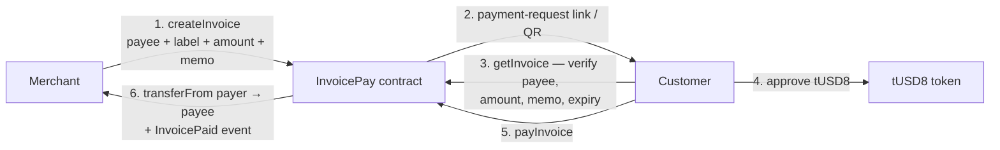

# Aevum Invoice Pay

**Invoice payments in tUSD8 on QDay Aevum Testnet — with confirmation of payee before anyone pays.**

Built for the **Aevum Builder Challenge #1** (QDay) — tracks *Invoice Payments* and
*Confirmation of Payee*. A merchant creates an on-chain invoice; the customer opens a
payment-request link (or scans its QR code), sees exactly **who** they are paying,
**how much**, and **what for**, then approves and pays. Funds move directly from
payer to payee — the contract never takes custody.

- Prize pool: $1,500 USDT ($800 / $500 / $200) · Submissions close **Dec 11, 2026 08:00 UTC**
- Challenge page: https://qday.io/builder-challenge · Submission: https://dorahacks.io/hackathon/qday/detail
- License: MIT

## The flow



1. **Create** — the merchant issues an invoice naming a payee address, a
   human-readable **payee label**, an exact tUSD8 amount, a memo, and an expiry.
2. **Share** — the dApp produces a payment-request link (`?invoice=<id>`) and a QR code for it.
3. **Confirm** — the customer's page reads the invoice from the chain and shows a
   *confirmation-of-payee* card: payee name + full address, amount, memo, expiry, status.
4. **Pay** — the customer approves tUSD8 and calls `payInvoice`. The contract checks
   the invoice is open and unexpired, records payer + timestamp, and pulls the exact
   amount straight to the payee. Status flips to `Paid`, verifiable on the explorer.

Safety properties: exact-amount only (no partial/over payment), expiry enforced,
issuer-only cancellation, effects-before-interaction in `payInvoice`, no custody,
no admin keys, no upgradeability.

## Network & addresses (verified 2026-11-19)

| Item | Value | Source |
|---|---|---|
| Network | QDay Aevum Testnet, chain ID **44005** (0xABE5) | [qday.io/build](https://qday.io/build) |
| RPC | `https://rpc-test.qday.info` (WSS `wss://rpc-test.qday.info`) | qday.io/build |
| Explorer | https://explorer-test.qday.info | qday.io/build |
| Native gas token | tQDAY (18 decimals) | qday.io/build |
| **tUSD8** (ERC-20, 6 decimals) | `0x456569838f1d43009A91ebA4263147Afd7233483` | [qday.io/official-links](https://qday.io/official-links), confirmed on-chain (symbol/decimals read via RPC) |
| QDayFaucet contract | `0xE5074CBbd046AFb491EB8692abD6cF7ECCC6dEE5` | qday.io/official-links |
| Web faucet | https://faucet.qday.info | challenge FAQ |
| **InvoicePay (this project)** | [`0x3022A50872AbeD36EfF6e6A4af991FD4Cb7998BB`](https://explorer-test.qday.info/address/0x3022A50872AbeD36EfF6e6A4af991FD4Cb7998BB) | deployed 2026-11-19 22:51 UTC, tx [`0x1f265dce…a5a039`](https://explorer-test.qday.info/tx/0x1f265dcec6b420db55567f1db6d5b1de98afbf53a4f6e1390b94ffbf5ca5a039); also in `deployment.json` |

## Funding a wallet with test tokens (read this first)

Verified on 2026-11-19 by probing the chain directly:

- The **on-chain faucet contract is currently `paused()` = true and holds 0 tQDAY /
  0 tUSD8**; a simulated `claim(address)` reverts with `EnforcedPause`. The wiki's
  in-docs claim widget calls this same contract, so it cannot dispense right now either.
- The **web faucet** (https://faucet.qday.info) relays claims for you, but it is gated by
  a **Cloudflare Turnstile captcha** and an anti-abuse rule: *the recipient address must
  hold ~0.0001 ETH, or 1 USDT, or 1 USDC on Ethereum mainnet*. A brand-new wallet
  therefore cannot use it for its first claim.
- The **Discord faucet works for fresh wallets**: join the QDay Discord, and in
  **#faucet** run `/faucet <your-address>` once — it sends **1 tQDAY + 5 tUSD8**.
  That is enough for the whole demo (deploy + full flow costs far less than 1 tQDAY).
- After one wallet is funded, it can forward tQDAY/tUSD8 to any other testnet address
  with ordinary transfers — `scripts/demo-flow.mjs` does this automatically for the
  demo's payer wallet.

Demo wallets used by the scripts (throwaway, testnet-only, generated locally;
keys live outside this repo):

- Merchant / issuer: `0x6D6c6C20e34bC031A02C25f2116910be4857D3dc`
- Payer / customer: `0x11cb59122475f1FF07D4073641bEB6F695E1bF83`

## Run it

Prerequisites: Node.js ≥ 18. No global tools needed (compilation uses the `solc` npm package).

```bash
npm install
npm test            # local end-to-end test: deploys InvoicePay + a mock tUSD8 to an
                    # in-process chain and runs create → approve → pay (no network needed)
```

Live on Aevum Testnet, once the merchant wallet is funded (see above):

```bash
node scripts/deploy.mjs      # deploys InvoicePay, writes deployment.json + app/config.js
node scripts/demo-flow.mjs   # full flow: top-up payer → plain transfer → create invoice
                             # → payer reviews → approve → pay → verify; writes demo-proof.json
node scripts/make-qr.mjs 1   # QR PNG for the payment-request link of invoice 1
npm run serve                # serves the dApp on http://localhost:8080
# or: docker build -t aevum-invoice-pay . && docker run -p 8080:8080 aevum-invoice-pay
```

The dApp (`app/`) connects MetaMask (or any EIP-1193 wallet), adds/switches to
Aevum Testnet automatically, shows tQDAY + tUSD8 balances, and provides both the
merchant view (create invoice → link + QR) and the customer view (confirmation of
payee → approve → pay → explorer link to the confirmed transaction).

## Test evidence

- **Local end-to-end test — PASSED** (2026-11-19, `npm test`): real `InvoicePay`
  bytecode on an in-process chain with a 6-decimal mock tUSD8: plain transfer
  0.25 tUSD8, invoice #1 created for 1.00 tUSD8, payer read-back shows the payee
  label/amount, approve + pay executed, final status `Paid`, merchant balance
  1.25 tUSD8 as expected.
- **Live Aevum Testnet run — PASSED** (2026-11-19 22:51–22:53 UTC, after the
  Discord `/faucet` funded the merchant wallet with 1 tQDAY + 5 tUSD8).
  `node scripts/deploy.mjs` deployed InvoicePay, then `node scripts/demo-flow.mjs`
  ran the full flow on-chain and wrote `demo-proof.json` (result: invoice #1
  **PAID**). Every transaction below is confirmed `success` on the explorer.
  Final balances reconcile exactly: merchant 4.25 tUSD8 (5.00 − 2.00 top-up
  + 0.25 plain transfer + 1.00 invoice), payer 0.75 tUSD8 (2.00 − 0.25 − 1.00).

| Step | Tx hash / explorer link |
|---|---|
| Deploy InvoicePay | [`0x1f265dce…a5a039`](https://explorer-test.qday.info/tx/0x1f265dcec6b420db55567f1db6d5b1de98afbf53a4f6e1390b94ffbf5ca5a039) |
| Top up payer — gas (0.05 tQDAY) | [`0x5f0f3c5a…ff8b3`](https://explorer-test.qday.info/tx/0x5f0f3c5a6a7086f3eb9bde09ba394b9a668ae9c6e892382f916a4726b8aff8b3) |
| Top up payer — tUSD8 (2.00) | [`0x3d299c58…1fd6`](https://explorer-test.qday.info/tx/0x3d299c58d441ea35559daa209d90b5de69ab8b74fbdcf4c5e80549490af41fd6) |
| Plain tUSD8 transfer (0.25, payer → merchant) | [`0xa72e5ff6…4f6d8`](https://explorer-test.qday.info/tx/0xa72e5ff67ff41cbf844083aba41b4910449fa837bbcbb73b936cb68d52b4f6d8) |
| Create invoice #1 (1.00 tUSD8) | [`0xe6b18f48…11744`](https://explorer-test.qday.info/tx/0xe6b18f482b6c4aa86fac20785395b0a6cb4aa281e1d6e70ca2d2ddfe51811744) |
| Approve tUSD8 (payer → InvoicePay) | [`0xdc941e1c…5b5f`](https://explorer-test.qday.info/tx/0xdc941e1c6bb65531d9b74500295fa8b7ebddd59e0dcfae6584b452d49a635b5f) |
| Pay invoice #1 | [`0xd7801c76…2816`](https://explorer-test.qday.info/tx/0xd7801c76dcd2ce7a898b979345595dbbe5ecf393e5be09804fcea797fb9e2816) |

## Repository layout

```
contracts/InvoicePay.sol    the payment contract (tUSD8 invoice registry)
contracts/MockUSD8.sol      test-only 6-decimal stand-in for local tests
app/                        static dApp (merchant + customer views, QR payment requests)
scripts/lib.mjs             chain config, wallet loading, helpers
scripts/compile.mjs         solc compile → artifacts/InvoicePay.json
scripts/deploy.mjs          deploy to Aevum Testnet
scripts/demo-flow.mjs       scripted end-to-end flow + proof file
scripts/local-test.mjs      offline end-to-end test (npm test)
scripts/make-qr.mjs         QR code for a payment-request link
scripts/build-app-config.mjs  regenerates app/config.js from deployment.json
scripts/probe-*.mjs         read-only diagnostics used to verify faucet/token facts
Dockerfile                  serves app/ on :8080
```

## How this maps to the judging criteria

- **Innovation (20)** — confirmation-of-payee as an on-chain, payer-verifiable step
  for stablecoin invoices; payment-request links + QR as the distribution mechanic.
- **UX & presentation (15)** — one page, plain-language errors, deep link opens the
  exact invoice to pay; merchant and customer views in a single screen flow.
- **Technical quality & integration (15)** — native Aevum deployment, official tUSD8,
  events for auditability, offline test suite, reproducible scripts.
- **Real-world utility (15)** — freelancers/merchants invoicing in stablecoins is the
  canonical first payment flow; the same contract extends to payroll batches and
  crowdfunding escrows (roadmap).
- **Safety, trust & controls (15)** — non-custodial, exact amounts, expiry,
  issuer-only cancel, least-privilege approvals (approve only the invoice amount).
- **Demo (10)** — scripted flow + live dApp, every step linked to the explorer.
- **Documentation (10)** — this README: setup, architecture, addresses, reproduction.

## Roadmap

- Invoice batches (payroll), optional escrow mode with release/refund paths,
  recurring invoices, x402/agent-wallet payment requests once QDay's agent layer
  tooling ships, mainnet deployment when QDay mainnet launches.

## Third-party dependencies & licenses

ethers.js (MIT), solc (Apache-2.0), ganache (MIT, dev/test only), qrcode (MIT);
CDN at runtime in the dApp: ethers.js UMD (MIT), qrcodejs (MIT). This project: MIT.
